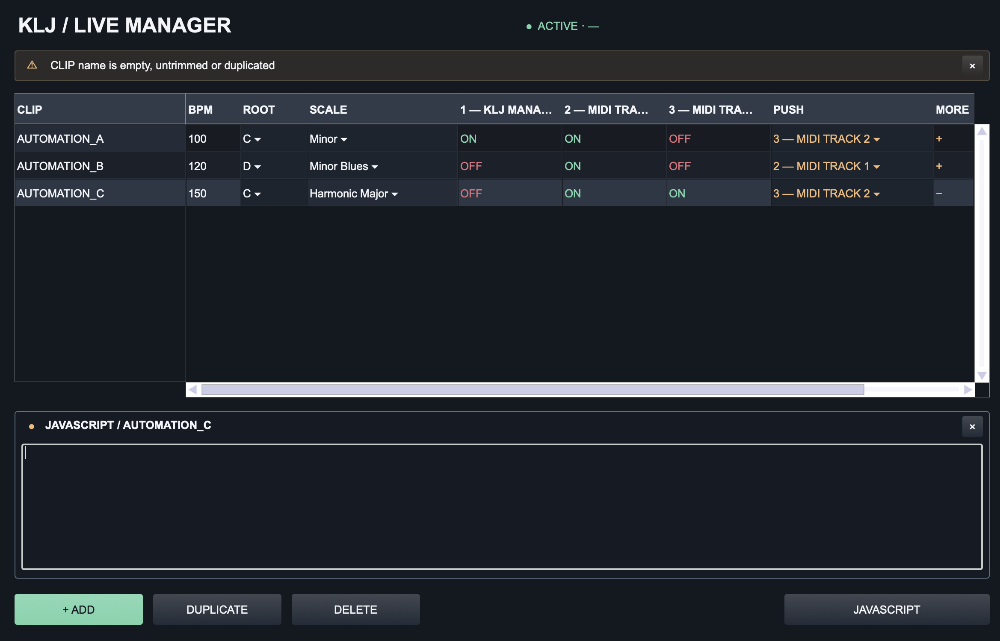

# KLJ Live Set Manager

*A Max for Live device we built to simplify the way we manage our Ableton Live set.*

[Download v1.7.0](https://github.com/scapetone/KLJ-live-set-manager/releases/download/v1.7.0/KLJ-Live-Set-Manager-v1.7.0.zip) · [Installation guide](INSTALLATION.md)

## Why we built this

We're **Kiss La Joue**, an electronic live project, and we've been building and refining our Ableton Live setup for quite a while.

Our set combines audio stems, multiple MIDI instruments, a keyboard controller and Push 2. We use Session View, scenes and Follow Actions to move between songs and sections.

The musical part of this setup works well. But behind the scenes, there's quite a lot to manage.

When moving from one song to another, we might need to change the tempo and scale, enable or disable several instruments, select the right track for Push, or switch specific effects on and off.

For years, we handled most of this with **ClyphX**, using macros triggered by clips in our Live set.

It worked, but as the set grew, so did the configuration files. Making changes meant going back into lines of commands, remembering what each one did and checking that nothing had been broken along the way.

We were also relying on an older Push 2 integration to support parts of that workflow, which wasn't ideal as we moved to newer versions of Live.

At some point, we started wondering:

*Could we keep the workflow we already like, but make all these configurations visible and editable in one place?*

That's where KLJ Live Set Manager started.

## What we came up with

The idea is pretty simple.

Each row in the editor represents a complete configuration for a song or section. Give that configuration a name, create a MIDI clip with the same name in Ableton, and the device recalls its settings when the clip starts playing.

From the editor, we can configure:

- **Tempo, root note and scale**
- **Which MIDI tracks monitor incoming notes**, using Monitor IN/OFF and allowing several instruments at once
- **Which track Push 2 should select**
- **Optional JavaScript actions**, for things like switching effects on or off

Everything is saved with the Ableton Live Set.

We deliberately kept the rest of our workflow unchanged. Ableton still handles scenes, clips and Follow Actions. Our audio stems and their mixing remain under manual control.

The device only handles the configuration changes we actually need.

## How we built it

This was also an experiment in building our own tools.

We started by documenting how our existing live setup worked, going through our ClyphX macros and identifying what we really needed to keep.

From there, we designed the interface and developed the Max for Live device with the help of **OpenAI Codex**.

There was quite a bit of trial and error: clip-name matching issues, unreliable menus, UI problems, Push integration limitations and plenty of testing directly in Ableton.

The development was AI-assisted, but the requirements, design choices, testing and iterations came from using the device in our actual musical setup.

It's been a useful experience in learning how far we can go with custom tools built around very specific needs.

## Where it stands

The current version is working in our Ableton Live 12 setup, including Push 2 track selection, configuration changes, custom JavaScript and saved configurations.

v1.6.0 improves background responsiveness and configuration recall: track changes are observed instead of periodically rescanning the whole Set, the closed editor suspends its visual work, and track-name checks are shared within each recall. **REFRESH TRACKS** provides manual resynchronization. Existing v1.5.1 configuration data keeps the same format; follow the [update instructions](INSTALLATION.md#updating-from-a-previous-version) to retain your configured instance.

v1.7.0 changes the MIDI matrix from mute control to **Monitor IN/OFF**: ON means IN, OFF means OFF. Track Activators/Mute, Device Activators, Arm and audio tracks are unchanged. If updating from v1.6.0, manually enable MIDI Track Activators left disabled by the previous version; Monitor IN does not unmute a track.

The author validated the Monitor candidate in their real test Live Set with the existing plugin replaced. See [release validation](validation/RELEASE-1.7.0.md) for evidence and [the update instructions](INSTALLATION.md#updating-from-a-previous-version) for retaining saved configurations.

There are still some limitations.

For example, Push 2 playing layouts (Note, In Key, Pads, etc.) aren't automatically switched by the device. We currently set these manually on Push, which remembers the layout as we change instruments.

Relaunching a clip that's already playing may not always be detected as a new trigger. And custom JavaScript isn't sandboxed, so scripts should be used carefully.

This is **not intended to replace everything ClyphX can do**, or to be a universal Ableton controller. It's a focused tool that works for our particular live setup.

We're sharing it because it might be useful to other musicians facing similar problems.

## Try it

You'll need **Ableton Live 12 with Max for Live and Max 9**.

Download the latest version from [GitHub Releases](https://github.com/scapetone/KLJ-live-set-manager/releases), keep the `.amxd` and its accompanying JavaScript files together, and load the device on a MIDI track containing your control clips.

The [installation guide](INSTALLATION.md) explains how to set up your first configuration.

## Feedback, ideas & contributions

This project started as a tool for our own live show, but we'd love to hear how other people approach similar challenges.

Maybe you use ClyphX, maybe you've built your own Max for Live devices, or maybe your Live set works completely differently.

**If you try KLJ Live Set Manager, we'd genuinely like to hear what you think.**

If something doesn't work, could be improved, or would make the device more useful in your setup, feel free to [open an issue](https://github.com/scapetone/KLJ-live-set-manager/issues).

Suggestions, bug reports, technical advice and ideas are all welcome. If you'd like to contribute code, let's discuss the approach in an issue first.

We're not promising to turn this into a large software project, but we're definitely open to learning from others and seeing where it could go.

---

*Made for Kiss La Joue, with curiosity, a lot of testing, and some help from AI.*

*The repository is public; licensing terms have not yet been defined.*
